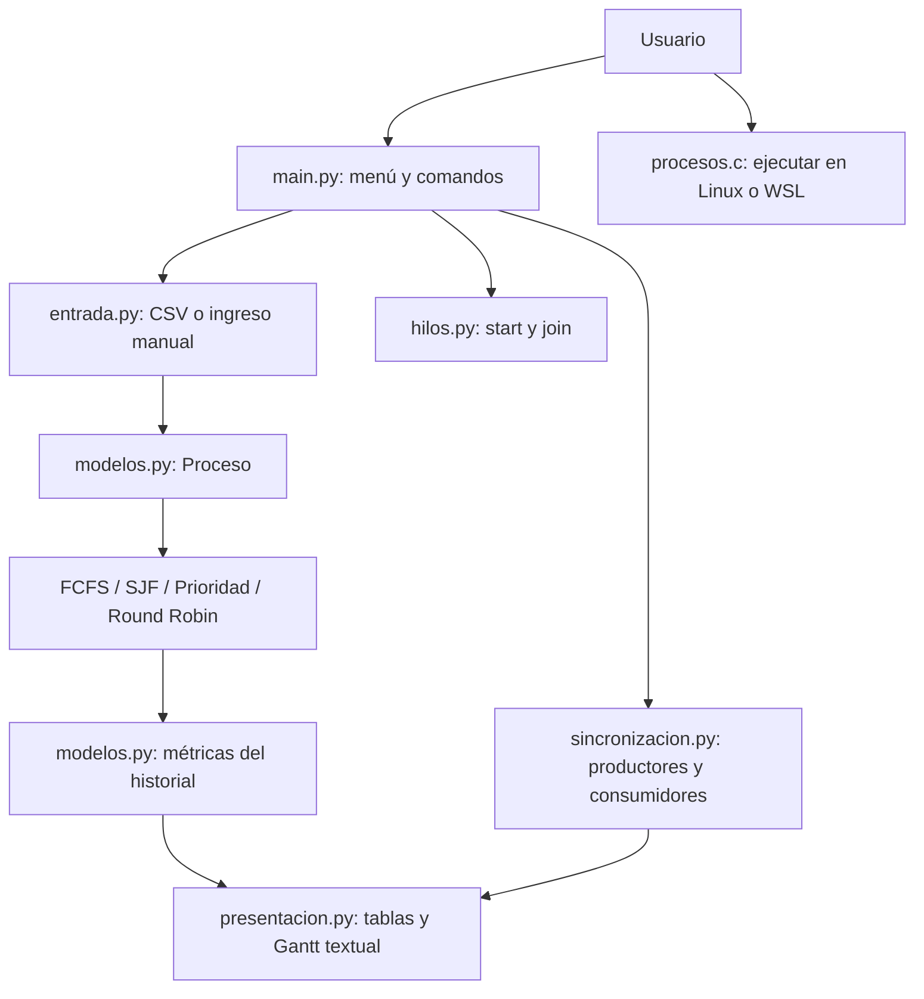

# Ficha técnica y arquitectura

## Alcance

**Proyecto:** SO-Sim — SuperAlmacén, simulador educativo de un sistema operativo.

**Curso:** SW407 — Sistemas Operativos, según el documento del proyecto.

**Entrega actual:** módulos 1 y 2. Cubre procesos, hilos, planificación y
sincronización. El módulo 1 corresponde a la entrega de la semana 4; el módulo
2 se trabaja desde la semana 5. La entrega completa de la semana 7 también
requiere memoria, que queda pendiente para la siguiente etapa autorizada.

**Integrantes y responsabilidades personales:** pendientes de completar por
el equipo. Las pruebas y el código del repositorio no sustituyen la evidencia
de participación individual que solicita la rúbrica.

## Elección de lenguajes

El caso común es el [almacén de un supermercado](caso_superalmacen.md).
Los procesos representan órdenes de trabajo; los hilos cuentan sectores de una
misma orden y el búfer es la zona donde recepción y ubicación intercambian cajas.
La mesa de preparación de pedidos representará la RAM en la etapa de memoria.
El caso documenta también E/S, archivos, seguridad y comunicación entre sucursales;
esas etapas todavía no forman parte de la implementación.

- C permite observar `fork`, `execvp` y `waitpid` directamente.
- Python facilita escribir los pasos de cada algoritmo y mostrar sus datos.
- `threading` proporciona hilos, semáforos y mutex reales para sincronización.

Se usan herramientas de la biblioteca estándar: `csv` lee el formato de
entrada, `argparse` interpreta comandos y `dataclasses` crea contenedores de
datos. Ninguna de ellas implementa las decisiones de planificación. El
productor-consumidor administra su propio búfer; no usa `queue.Queue`.

## Componentes



Los módulos se reúnen mediante la consola y la documentación. La demostración
de C se compila y ejecuta aparte para observar las llamadas del sistema.
El planificador no controla los procesos reales creados por C: simula una CPU
con un reloj virtual para permitir comparaciones reproducibles.

## Organización

```text
so-sim/
  c/procesos.c               Demostración de procesos POSIX
  python/
    main.py                  Menú y comandos
    entrada.py               Validación y lectura de las cuatro columnas
    modelos.py               Datos, tramos de CPU y métricas
    evaluacion.py            Porcentajes de atención y reducción de tiempos
    planificacion/
      fcfs.py                Orden de llegada
      sjf.py                 Menor duración disponible
      prioridad.py           Mayor prioridad disponible
      round_robin.py         Cola de listos y quantum
    hilos.py                 Conteo por sectores y comparación de tiempos
    sincronizacion.py        Búfer circular y productor-consumidor
    presentacion.py           Tablas, trazas y comparación
  data/processes/             Ejemplos CSV
  tests/                     Pruebas automatizadas
  docs/                      Explicaciones para el informe
```

## Decisiones para facilitar la explicación

- Cada algoritmo tiene su ciclo de selección visible en un archivo propio.
- Los nombres de variables describen su función: `tiempo`, `pendientes`,
  `cola_listos`, `restantes`, `entrada`, `salida` y `ocupacion`.
- Los comentarios explican decisiones, desempates y orden de sincronización.
- La representación de un proceso es inmutable para poder ejecutar todos los
  algoritmos sobre los mismos datos sin alterar la entrada.
- Las métricas se calculan desde el historial. Así es posible contrastar la
  tabla con cada intervalo mostrado por el algoritmo.

## Orden sugerido para la exposición

1. Explicar las cuatro columnas y los supuestos de la simulación.
2. Mostrar la creación y terminación de un proceso real en C.
3. Mostrar la diferencia entre iniciar un hilo y esperar su finalización.
4. Seguir FCFS y luego explicar qué cambia en SJF y Prioridad.
5. Recorrer la cola de Round Robin y calcular una métrica a mano.
6. Mostrar el búfer circular y por qué se necesitan dos semáforos y un mutex.
7. Ejecutar las pruebas y comparar los resultados del mismo conjunto de datos.
